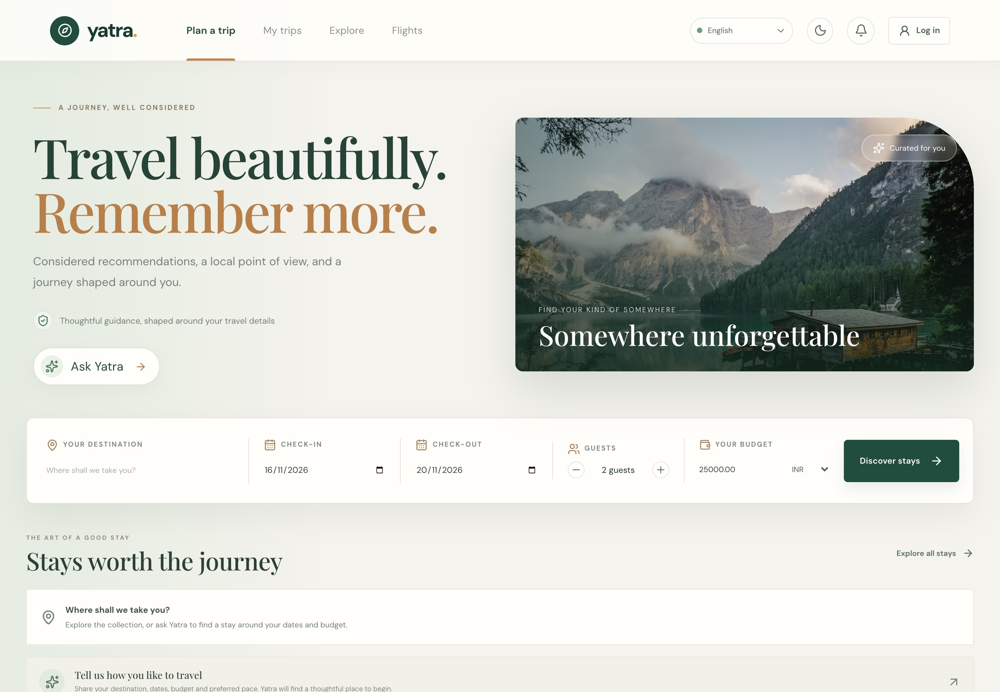
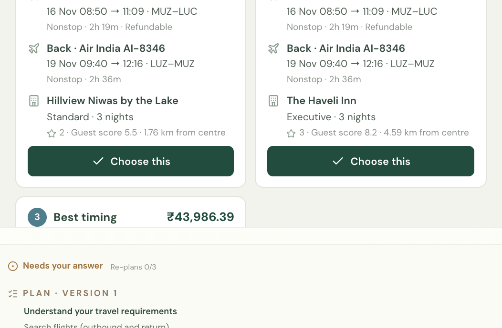
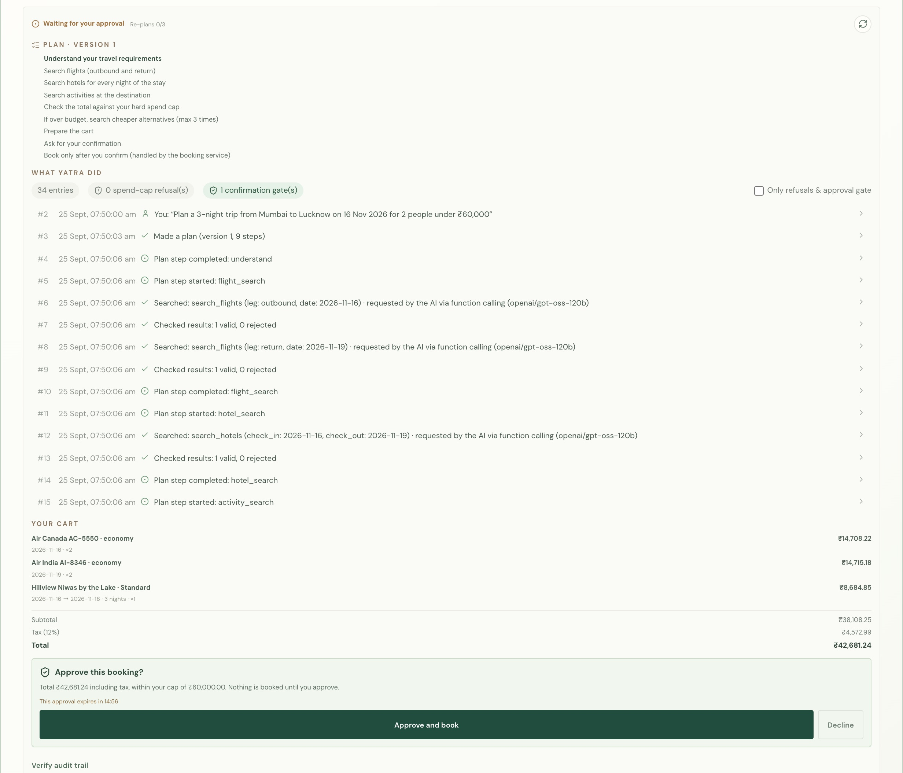
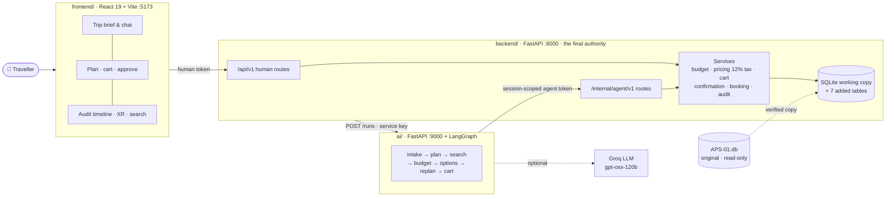
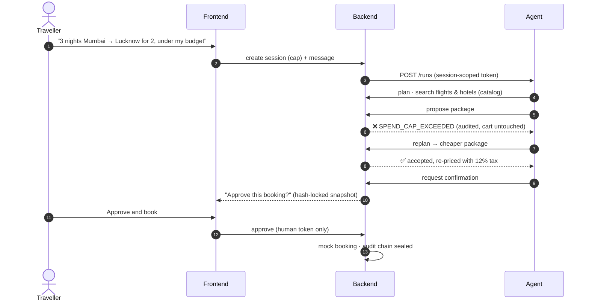
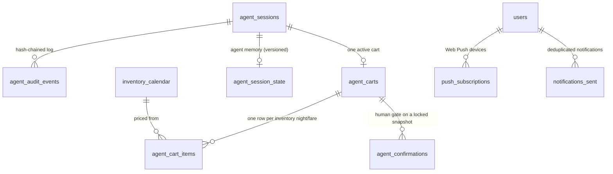
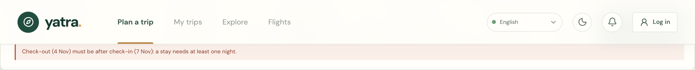
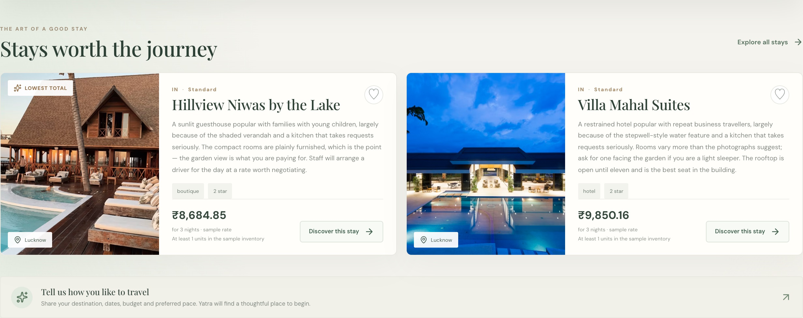
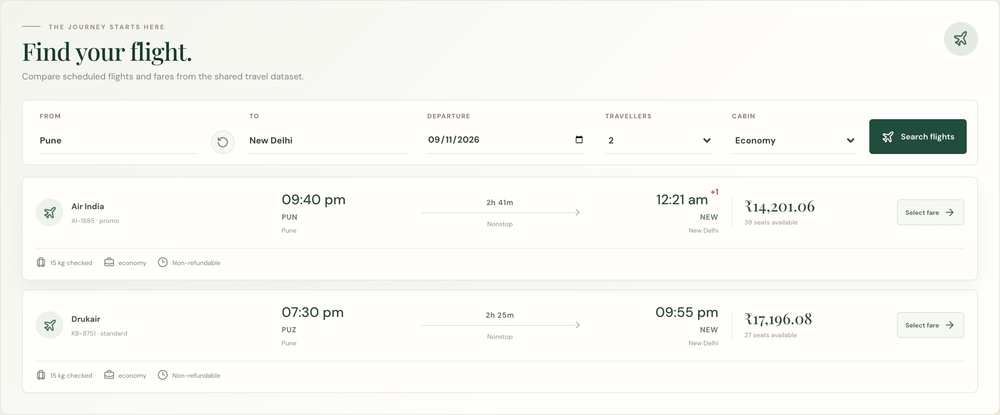
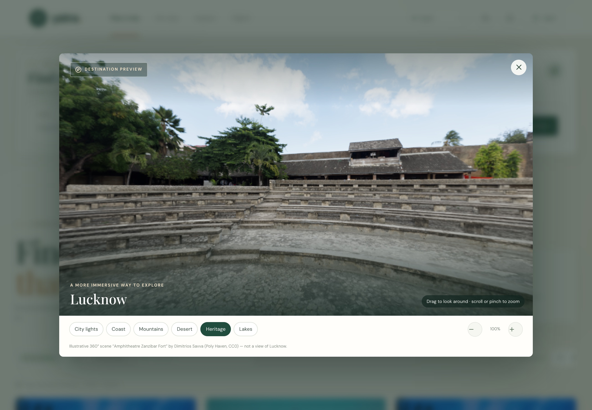

<div align="center">

# 🧭 Yatra

### Agentic AI Travel Concierge: Autonomous Planning & Booking

**The agent proposes. The backend decides. The traveller approves.**

[](#-1-team--problem-statement)
[](#-1-team--problem-statement)
[](#-8-tests--proof)




[What we built](#-2-what-we-built) · [Architecture](#-3-architecture) · [Data model](#-4-data-model) · [AI](#-5-ai-features) · [Run it](#-6-run-it-locally) · [Demo](#-7-demo-path) · [Tests](#-8-tests--proof)

</div>

---

## ✨ At a glance

<table>
<tr>
<td align="center" width="25%"><h3>3</h3>independent services<br><sub>UI · backend · agent</sub></td>
<td align="center" width="25%"><h3>0</h3>ways to book without a “yes”<br><sub>hash-locked human approval</sub></td>
<td align="center" width="25%"><h3>₹0.01</h3>over the cap is refused<br><sub>code, DB trigger and tests</sub></td>
<td align="center" width="25%"><h3>25</h3>UI languages<br><sub>Hindi agent replies</sub></td>
</tr>
</table>

---

## 👥 1. Team & Problem Statement

| | |
|---|---|
| **Team** | **Tech4ce** · CMRIT |
| **Problem Statement** | **APS-01: Agentic AI Travel Concierge — Autonomous Planning & Booking** |
| **Event** | KogniVera Hackathon 2026 · Travel & Tourism · data model v1.1.0-rc2 |
| **In one line** | A conversational agent that turns a trip goal into a costed flight + hotel plan. It never goes over a hard spend cap, and it books only after the traveller explicitly approves. |

> [!IMPORTANT]
> APS-01's key rule: *“`spend_cap` is a hard gate and `requires_confirmation` cannot be bypassed.”*
> Yatra is built around it. The AI can **suggest** anything; only the backend can **accept** it, and only the traveller can **book** it.

---

## 🚀 2. What we built

Every item on the APS-01 MVP checklist works end-to-end, **UI → backend → agent → database**:

- **🗣️ Goal intake → transparent plan.** Free text like *“3 nights Mumbai → Lucknow on 16 Nov for 2 under ₹60,000”* becomes origin, destination, dates, party and cap. Missing or impossible details are asked about, never guessed. The 9-step plan is published *before* anything runs, and each step is shown live. <sub>`ai/travel_agent/nodes/intake.py` · `graph.py`</sub>
- **🔧 Tool use over real inventory.** The agent calls `search_flights`, `search_hotels` and `check_budget` through the backend's catalog. Each call is audited with who requested it (the LLM or the workflow), and the backend re-prices every offer. <sub>`ai/travel_agent/tool_planner.py` · `backend/src/services/offer_service.py`</sub>
- **🛑 Hard spend cap.** `MIN(session cap, agent_sessions.spend_cap, budgets.total)` vs committed + cart incl. 12% tax, re-checked on **every** change. An over-cap offer is refused with `SPEND_CAP_EXCEEDED`, audited, and never reaches the cart. <sub>`backend/src/services/budget_service.py`</sub>
- **🔁 Recovery & replanning.** After a refusal or a sold-out option, the agent replans within the cap (max 3). If nothing fits, it stops cleanly and says why. It suggests real alternative dates when a route has no flight. <sub>`ai/travel_agent/nodes/replan.py` · `flight_search.py`</sub>
- **✋ Human confirmation → mock booking.** The traveller approves a hash-locked cart snapshot with a human-only token (15-min expiry). Only then does the mock booking write `holds`, `bookings`, `booking_items` and `payments`. The agent's token cannot approve. <sub>`backend/src/services/confirmation_service.py` · `booking_service.py`</sub>
- **🧾 Verifiable audit trail.** Every step, tool call, refusal, approval and booking is an append-only, hash-chained event, shown as a timeline, with one-click **Verify audit trail**. <sub>`GET /api/v1/sessions/{id}/audit/verify`</sub>

<table>
<tr>
<td width="46%" valign="top"><br><sub><b>Three packages, all within the cap</b>: best value, most comfortable, best timing</sub></td>
<td width="54%" valign="top"><br><sub><b>Plan → audit timeline → cart → “Approve this booking?”</b> Nothing is booked until you approve.</sub></td>
</tr>
</table>

**Beyond the MVP:** flight and stay search, My Trips with the saved conversation, a **WebXR 360° destination preview**, **Web Push** trip reminders, 25 UI languages, and currency conversion.

---

## 🏗️ 3. Architecture



**How a booking actually happens.** The model can suggest, but only the backend and the traveller can say yes:



| Component | Owns | Key paths |
|---|---|---|
| 🎨 **Frontend** | Trip brief, chat, plan and cart, approve/decline, audit timeline, flight/stay search, XR | `frontend/src/app/` |
| 🛡️ **Backend** | The database, cap, tax, pricing, confirmation gate, booking and audit | `backend/src/{api,services,db,core}` |
| 🤖 **Agent** | Planning and proposals, over HTTP only. **No DB access, no secrets** | `ai/service.py`, `ai/travel_agent/` |
| 🗄️ **Data** | A stamped working copy of `APS-01.db` plus 4 checksum-locked migrations | `backend/src/db/migrations/`, `data-model/` |

The agent never imports backend code; `tests/safety/test_agent_isolation.py` enforces this. More detail in [`docs/ARCHITECTURE.md`](docs/ARCHITECTURE.md).

<details>
<summary><b>📁 Repository layout</b></summary>

```text
kv-hack2026-tech4ce/
├── README.md
├── frontend/                  UI app: React 19 + TypeScript + Vite
│   ├── src/                   app/ pages · services/ API client · i18n/ 25 languages · utils/ money + dates
│   ├── tests/                 date tests (npm test → 5 time zones)
│   └── package.json
├── backend/                   API: FastAPI, the final authority
│   ├── src/                   api/ routes · services/ cap, pricing, cart, confirmation, booking, audit
│   │                          core/ money, dates, tokens · db/ repositories + migrations 0001–0004
│   ├── scripts/               make_working_copy · apply_migrations · seed_demo · demo_reset · verify_db · make_vapid_keys
│   └── requirements.txt
├── data-model/
│   ├── schema.sql             every addition (the 4 checksum-locked migrations)
│   ├── seed/                  demo_seed.json, loaded by backend/scripts/seed_demo.py
│   └── DATA_MODEL.md          canonical tables used + additions and why
├── ai/                        agent service
│   ├── prompts/               intake · planner · clarify · replan
│   ├── travel_agent/          pipeline: LangGraph graph, nodes, tools, LLM + function calling
│   ├── service.py             FastAPI wrapper (:9000)
│   └── backend_client.py      the only way the agent reaches the backend (HTTP)
├── docs/
│   ├── ARCHITECTURE.md
│   ├── live_demo.py           demo script: the full flow headless, against real services
│   └── images/ · presentation/   screenshots · pitch decks
├── tests/                     unit · integration · e2e · safety (hard proof) · ai
├── .env.example               every env var, with dummy values
└── .gitignore
```

</details>

---

## 🗄️ 4. Data model

The canonical APS-01 data model is the source of truth and is used **unmodified**: every table and column name is kept, and no canonical column is added. The original `APS-01.db` is **never written**; the app opens only a verified, stamped working copy. *(The APS-01 pack names its tables rather than numbering them D1–D9, so they are listed by canonical name.)*

| Purpose | Canonical tables | Access |
|---|---|---|
| Identity & trip context | `users`, `trips`, `budgets` | read (demo seed rows only) |
| Agent session / spend cap | `agent_sessions` | read + a few column updates |
| Catalogue | `cities`, `airports`, `airlines`, `flights`, `flight_fares`, `hotels`, `hotel_room_types`, `currencies` | read |
| Availability | `inventory_calendar` | read; `held_units` updated when a hold is placed or released |
| Booking | `holds`, `bookings`, `booking_items`, `payments` | insert (mock booking) |
| My Trips | `itineraries`, `itinerary_items` | read |

`countries`, `languages` and `eval_nl_search_set` are kept intact, and languages are BCP-47 tags (rule R6).

**➕ What we added:** 7 tables, 2 indexes on `flights` / `flight_fares`, and no changes to canonical columns. Why each exists is in [`data-model/DATA_MODEL.md`](data-model/DATA_MODEL.md); the full DDL (migrations 0001–0004, SHA-256-locked) is in [`data-model/schema.sql`](data-model/schema.sql).



💰 **Money never touches a float.** Existing tables keep 2-decimal strings; new tables use integer minor units (paise).

---

## 🤖 5. AI features

| Capability | Mechanism | Grounding: why it can't make things up |
|---|---|---|
| **Goal understanding** | Rule-based extractor for cities, dates, nights, party and budget. Gaps are filled by an optional LLM (Groq `openai/gpt-oss-120b`, JSON mode) | Cities must resolve to a real `cities.city_id`; dates, party and currency are validated in code. **The cap never comes from the LLM.** |
| **Tool selection** | LLM **function calling** over `search_flights`, `search_hotels` and `check_budget` | Each call's arguments must match the extracted requirements exactly, or the workflow's own call is used. The audit shows `requested_by`. |
| **Agentic workflow** | LangGraph `StateGraph`: intake → planner → flight / hotel / activity search → budget → options → replan → cart | Every search reads live inventory through the backend, which re-prices and re-validates each offer |
| **Option ranking** | Up to 3 distinct packages (value / comfort / timing) that fit the cap, tuned by preference cues (“cheaper”, “better hotel”, “morning flights”) | Built only from returned fares and room nights |
| **Replanning** | Cheaper combinations after a refusal; real alternative dates when a route is empty | Alternative dates come from a SQL query over bookable fares |
| **Multilingual** | Script detection plus BCP-47 message tables; Hindi agent replies; 25 UI language packs | The language tag travels with the session |

> [!NOTE]
> The LLM is **optional and fail-safe**. Without `GROQ_API_KEY` (or with `TRAVEL_AGENT_DISABLE_LLM=1`) the agent is fully deterministic, which is how the test suite runs. No LLM output ever reaches budget logic, routing or booking.

---

## 🛠️ 6. Run it locally

| Need | Version |
|---|---|
| Python | 3.13 |
| Node.js | 20+ |
| Data | `APS-01.db` from the APS-01 data pack (`data/APS-01.db`) |

**① Install**

```bash
git clone https://github.com/sharathkudachi/Yatra-Saathi.git && cd "Yatra Saathi"
python3.13 -m venv backend/.venv
backend/.venv/bin/pip install -r backend/requirements.txt -r ai/requirements.txt   # one venv: backend, agent, tests
(cd frontend && npm install)
```

**② Environment.** Every variable is listed with dummy values in [`.env.example`](.env.example).

```bash
cp backend/.env.backend.example backend/.env.backend    # set APS_DB_ORIGINAL_PATH, APS_DB_PATH and the 3 secrets
cp ai/.env.agent.example        ai/.env.agent           # same AGENT_SERVICE_KEY; GROQ_API_KEY optional
cp frontend/.env.example        frontend/.env.local     # VITE_USE_MOCK_API=false
# secrets:   backend/.venv/bin/python -c "import secrets; print(secrets.token_hex(32))"
# Web Push:  (cd backend && .venv/bin/python -m scripts.make_vapid_keys)   # optional
```

**③ Migrate & seed** (from `backend/`)

```bash
cd backend && set -a && . ./.env.backend && set +a
.venv/bin/python -m scripts.make_working_copy    # verify the original's SHA-256, copy it, stamp the copy
.venv/bin/python -m scripts.apply_migrations     # migrations 0001–0004 (checksum-locked), working copy only
.venv/bin/python -m scripts.seed_demo            # demo user usr_demo0001 + trip + budget
.venv/bin/python -m scripts.verify_db            # optional: fingerprint, schema, integrity
# one-shot reset before a demo:  .venv/bin/python -m scripts.demo_reset
```

**④ Start** (three terminals)

```bash
# backend  :8000
cd backend && set -a && . ./.env.backend && set +a && .venv/bin/python -m uvicorn src.main:app --reload --port 8000
# agent    :9000
cd ai && set -a && . ./.env.agent && set +a && ../backend/.venv/bin/python -m uvicorn service:app --port 9000
# frontend :5173
cd frontend && npm run dev
```

**⑤ Open**

| 🌐 Open | URL |
|---|---|
| App | **http://localhost:5173** |
| API docs | http://localhost:8000/docs |
| Health | http://localhost:8000/api/v1/health · http://localhost:9000/health |

> [!TIP]
> The backend and agent **deliberately** use separate env files, so the agent never sees backend secrets. The root [`.env.example`](.env.example) lists every variable. To reset the demo at any time, run `python -m scripts.demo_reset`.

---

## 🎬 7. Demo path

**Terminal outcome:** a mock booking made only after explicit human approval, within the hard cap, with a verified audit trail.

> Start from a clean demo: `cd backend && .venv/bin/python -m scripts.demo_reset` (then restart the backend).

1. Open **http://localhost:5173** → **Log in** with User ID `usr_demo0001`, Name `[DEMO] Traveller`, Email `demo.traveller@example.invalid`.
2. **Show the hard cap.** In the **Yatra trip agent** chat, send:
   ```text
   Plan a 3-night trip from Mumbai to Lucknow on 16 Nov 2026 for 2 people under ₹30,000
   ```
   The session panel shows the plan, then the searches. Every package is **refused by the backend** (`SPEND_CAP_EXCEEDED`, e.g. *“₹42,681.24 is over cap ₹30,000.00”*). The agent **replans 3 times** and stops: *“Still over budget after 3 replans … raise the budget.”* Nothing is booked. Tick **Only refusals & approval gate** to see each refusal.
3. **Plan within budget.** Send:
   ```text
   Plan a 3-night trip from Mumbai to Lucknow on 16 Nov 2026 for 2 people under ₹60,000
   ```
   Yatra offers **3 packages** (best value / most comfortable / best timing), all within the cap.
4. Click **Choose this** on a package. The cart shows every line, 12% tax and the total vs cap. The status becomes **Waiting for your approval** (*“Approve this booking?”*).
5. Click **Approve and book** → status **Booked**, and Yatra replies with a **booking reference**.
6. Click **Verify audit trail** → *“Audit trail verified: complete and untampered.”* ✔️

<details>
<summary><b>🧪 Try the guardrails</b></summary>

| Try | What happens |
|---|---|
| Check-out before check-in on the search bar | Inline message; search is blocked; dates are never swapped |
| “departing 07/11/2026 returning 04/11/2026” in chat | Yatra asks which dates you meant; no planning request is sent |
| A past date | Refused in the date picker, the form, the API (`DATE_IN_PAST`) and the agent |
| Flights · Pune → New Delhi · 9 Nov 2026 | AI-1885 lands at 12:21 am **+1** and is still bookable |



</details>

Headless version of the same flow (the demo script): `backend/.venv/bin/python docs/live_demo.py` from the repo root, with `APS_DB_ORIGINAL_PATH` set.

---

## ✅ 8. Tests / proof

```bash
# repo root, backend venv
set -a; . backend/.env.backend; set +a          # needs APS_DB_ORIGINAL_PATH
backend/.venv/bin/python -m pytest -q tests     # → 247 passed, 113 subtests

cd frontend && npm test                         # → 8 date tests × 5 time zones
```

Every database test runs on a temporary copy and checks the original's SHA-256 **before and after**.

| Suite | Covers |
|---|---|
| `tests/unit/` | Money (strings / minor units, no floats), dates and flight times, core utilities |
| `tests/integration/` | Migrations and checksums, agent flow through the services, currency conversion |
| `tests/e2e/` | Full HTTP flow, search validation, the demo story (including a backend restart mid-confirmation) |
| `tests/safety/` | Original-DB protection, 30+ DB triggers and CHECKs, agent import isolation |
| `tests/ai/` | Extraction, budget, options, replanning, trip dates, and the agent against the **real** backend |
| `frontend/tests/` | Date-only handling (no off-by-one-day shifts), overnight flights, trip-date rules |

### 🔒 Hard proof: the agent cannot spend over the cap, or without a “yes”

| Guarantee | Test |
|---|---|
| Over-cap offer refused, cart untouched | `tests/integration/test_agent_flow.py` · `test_spend_cap_refuses_over_budget_and_does_not_touch_cart` |
| Cart refuses over-cap even if the budget check is skipped | `tests/ai/unit/test_replanning.py` · `test_cart_refuses_over_cap_even_if_budget_check_is_bypassed` |
| DB trigger rejects a cart total above the cap | `tests/safety/test_schema_triggers.py` · `test_total_cannot_exceed_cap` |
| Booking without an approved confirmation is refused | `tests/integration/test_agent_flow.py` · `test_confirmation_bypass_without_confirmation_is_refused` |
| An agent token cannot approve | `tests/e2e/test_http_flow.py` · `test_rogue_agent_cannot_approve_confirmation` |
| Real agent → real backend: refused, replanned, stops at confirmation | `tests/ai/test_agent_integration.py` |
| Full demo story with audit verification | `tests/e2e/test_demo_story.py` |

```bash
backend/.venv/bin/python -m pytest -q tests -k "cap or confirmation or rogue"
```

---

## 📐 Data-model conformance

- **Source of truth:** the canonical APS-01 schema. No canonical table or column is renamed, dropped or altered.
- **Additions:** 7 tables (5 `agent_*` + `push_subscriptions` + `notifications_sent`) and 2 indexes, all documented with the reason for each in [`data-model/DATA_MODEL.md`](data-model/DATA_MODEL.md). Migrations 0001–0004 are **SHA-256-locked** and refuse to run against the original.
- **Boundary rules enforced in backend code, each with a test:**

| Rule | Enforced in | Tested by |
|---|---|---|
| Hard spend cap | `budget_service.py` + DB trigger | hard-proof table above |
| Confirmation before booking | `confirmation_service.py` (hash-locked, human-only, TTL) | `test_agent_flow.py`, `test_http_flow.py` |
| No oversell / capacity | `offer_service.py` (availability, closed-to-arrival, occupancy) | `test_schema_triggers.py`, `test_search.py` |
| Exact money | `core/money.py` | `tests/unit/test_money.py` |
| Supported ISO-4217 currency | `schemas/human.py`, `core/fx.py` | `test_currency_conversion.py` |
| Server-side 12% tax | `pricing_service.py` (`TAX_RATE_BP`) | `test_money.py`, `test_agent_flow.py` |
| Valid trip dates: `YYYY-MM-DD`, not in the past, end after start (1–30 nights), flights compared by exact instant | `core/dates.py`, `schemas/human.py`, search & session routes, `offer_service.py`, agent `intake.py` | `test_dates.py`, `test_search.py`, `test_http_flow.py`, `test_trip_dates.py`, `frontend/tests/dates.test.ts` |
| Original DB never modified | `db/working_copy_guard.py` | `tests/safety/test_original_protection.py` |

---

## 🖼️ More screenshots

<table>
<tr>
<td width="50%"><br><sub><b>Stays</b>, priced exactly as the cart prices them</sub></td>
<td width="50%"><br><sub><b>Flights</b>, in each airport's local time; +1 for arrivals after midnight</sub></td>
</tr>
<tr>
<td width="50%"><br><sub><b>Explore in XR</b>: drag, zoom or enter VR on a WebXR headset</sub></td>
<td width="50%" align="center"><br><sub><b>Responsive</b> down to phone width</sub></td>
</tr>
</table>

---

## 🧰 Tech stack

| Layer | Technology |
|---|---|
| Frontend | React 19 · TypeScript · Vite 8 · Tailwind · Three.js (WebXR) · lucide icons |
| Backend | Python 3.13 · FastAPI · Pydantic 2 · SQLite (working copy) · pywebpush |
| Agent | LangGraph · Groq (`openai/gpt-oss-120b`, optional) · httpx |
| Quality | pytest / unittest · Node test runner · checksum-locked migrations · hash-chained audit |

---

## ⚠️ Known limitations

- Inventory is the seeded dataset; there is no live airline or hotel provider. Booking and payment are **mocked**.
- Activities are informational only; the dataset has no bookable activity table.
- Sign-in matches an existing `users` row (ID + name + email). That's fine for the demo, but it isn't real authentication.
- The XR preview uses illustrative CC0 panoramas, not imagery of the listed properties.
- Flights are filed under their India-time departure date (the dataset's convention), so a flight leaving a foreign city after local midnight appears under the previous date.

---

<div align="center">

**Built in 24 hours by Team Tech4ce (CMRIT)** for the KogniVera Hackathon 2026 · APS-01

<sub>The agent proposes. The backend decides. The traveller approves. 🧭</sub>

</div>
